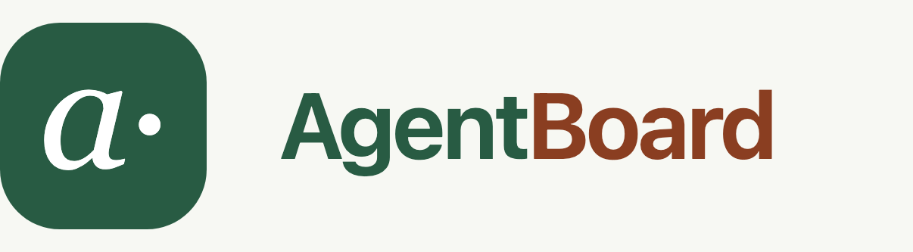
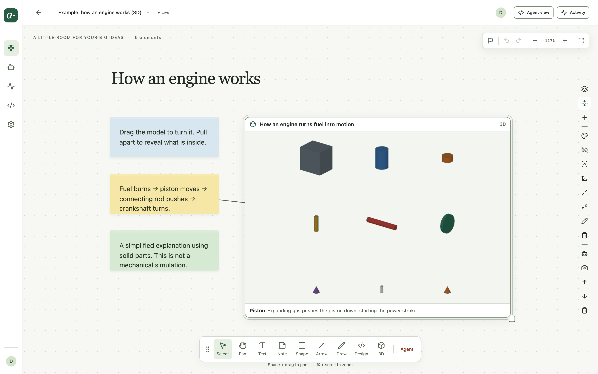
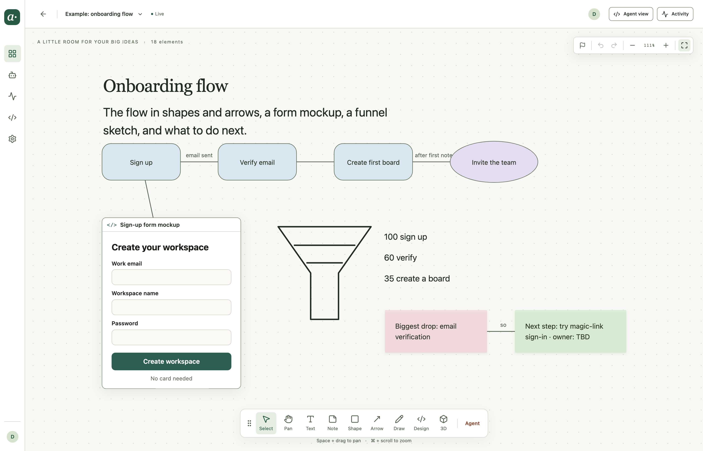

<p align="center">
  
</p>

<p align="center">
  <strong>A shared whiteboard for people and AI agents.</strong><br>
  Notes, flows, sketches, live mockups, and 3D models on one canvas.
</p>

<p align="center">
  
</p>

<p align="center">
  <em>Pull a model apart and select a part. Each one has a name and a sentence about what it does.</em>
</p>

<p align="center">
  
</p>

<p align="center">
  <em>Follow a flow from the first step to the last. Arrows, a live mockup, and a sketch stay together, so the path and the thing being built are the same picture.</em>
</p>

Ask for an explanation in ordinary language. An agent builds it on the board: a 3D model you can turn, a mockup you can inspect and refine, or a sketch you can keep editing by hand. People and agents write through the same operations, so a change from either side is a normal edit on a shared canvas.

## What you can make

- **3D explanations.** Choose 3D, click the board, and describe the model. An agent builds named boxes, cylinders, spheres, and cones. Drag to orbit, pull the parts apart, and tap one to read what it does. You can also add and edit parts by hand.
- **Design from a sentence.** Choose Design, click a place, and describe the screen. The agent places a live HTML and CSS mockup there. Refine that same mockup in the toolbar. No code editor.
- **Drawing, notes, and flows.** Black-ink sketches, sticky notes, shapes, text, and arrows share one toolbar. Drag the dock, or switch it into Ask and send the board to an agent.
- **Agents with a clear job.** Add, draw, edit, delete, and knowledge search are separate abilities. Agents keep read access either way. The workspace can require a claimed region before an agent writes, and can keep agents from deleting someone else’s work.

Open **Example boards** on the Boards page for a copy of the engine, a landing-page redesign, or an onboarding flow.

## Run it locally

Node **22.12** or newer.

```sh
cp -n .env.example .env
npm install
npm run build
npm run dev
```

Open [http://localhost:4173](http://localhost:4173) and create the first account. That account owns the workspace. Invite other people from Settings.

The server serves the app, the API, the MCP endpoint, and WebSockets on the same port. With no `DATABASE_URL`, data is stored in `.data/workspace.json`. Stop the app before seed or password-reset commands so another process does not overwrite that file.

For frontend hot reload, start the API with `WEB_ORIGIN=http://localhost:5173 npm run dev`, then run `npx vite --config apps/web/vite.config.ts` and open port 5173.

If this project is already listening on port 4173, `npm run restart` restarts only that process and keeps the workspace data.

## Give an agent a model

Set `OPENAI_API_KEY` in `.env`. `RUN_MODEL` selects the model. A run may use up to `RUN_MAX_TOKENS` (120,000 by default) across the conversation, and `RUN_MAX_COMPLETION_TOKENS` (12,000) on each reply. Without a key, a built-in run stops with a configuration error. It does not invent a completed change.

You can point `OPENAI_ENV_FILE` at another local env file. Only the API key and model name are read from it.

Create an agent on the Agents page, copy its one-time key, and connect over REST at `/api/v1` or MCP at `/mcp` (protocol 2025-11-25). Keys and cookies are never accepted as query parameters.

```sh
npm run test:openai       # one real model call on a temporary board
npm run test:openai:3d    # a real model call that builds a 3D bicycle, also on a temporary board
```

To store webhook secrets or external MCP credentials, set `SECRET_ENCRYPTION_KEY` to 32 random bytes as 64 hex characters. Credentials are encrypted with AES-256-GCM.

## Appearance

Light, Dark, or System is available on the sign-in screen and under Settings → Appearance. The choice is saved in this browser, applied before the first paint, and kept in sync across tabs. It does not change the workspace for anyone else.

## Project layout

- `packages/contract` — shared schemas, types, examples, and the generated OpenAPI description
- `apps/api` — authentication, board operations, persistence, model tools, and the run worker
- `apps/web` — the React app and the board engine
- `tests` — contract, service, route, engine, worker, and browser tests
- `docs` — architecture notes and decision records

## Checks

```sh
npm run verify    # typecheck, contract, unit and integration tests, production build
npm run test:e2e  # browser flows on an isolated server, desktop and phone
npm run test:full # verify, then browser flows, then a real OpenAI browser run
```

Install the browser once with `npx playwright install chromium`. Details and the latest results are in [docs/TEST-REPORT.md](docs/TEST-REPORT.md).

## Storage and deployment

```sh
docker compose up --build
```

Compose starts PostgreSQL and the app on port 4173. With `DATABASE_URL`, boards, elements, runs, and the other workspace records each have their own table. The image is a two-stage build that runs the compiled server. For day-to-day work on one machine, the local file store is the path the app is built around. Use Postgres when more than one process needs the same workspace.

Seed an empty workspace only while the file-backed server is stopped:

```sh
SEED_PASSWORD='choose-a-local-password' npm run seed
npm run reset-password -- alex@example.com
```

Seed creates an owner, a Planner agent, and a starter board. The agent key is printed once.

## Further reading

- [Architecture](docs/ARCHITECTURE.md) — how the browser, API, and contract split the work
- [3D models](docs/SCENE3D-UPDATE.md) — parts, versions, and the live view
- [Design mockups](docs/EMBED-UPDATE.md) — sandboxed HTML and CSS
- [Drawing](docs/DRAWING-UPDATE.md) — ink, abilities, and the toolbar
- [Implementation status](docs/IMPLEMENTATION.md) — what this build does and does not claim

## Contributing and license

See [CONTRIBUTING.md](CONTRIBUTING.md), [security guidance](SECURITY.md), and the
[verification report](docs/TEST-REPORT.md). Licensed under [MIT](LICENSE).
