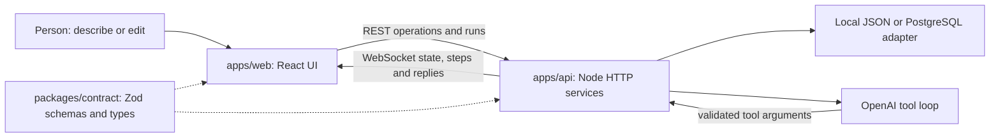

# Frontend/backend boundary

## Frontend

BoardPage coordinates gestures, selection, serialized pending commits and confirmed/live snapshots. BoardToolbar collects descriptions and structured design targets; it does not construct model prompts, access credentials or call OpenAI. Scene3DSelectionBar is a transparent vertical icon rail with labelled popovers and accessible button names. Scene3DView loads Three.js lazily and owns local exploration state through the card/controller.

The browser never writes storage directly. A local optimistic overlay is replaced by authoritative API state. Response selection is keyed by run ID; a late create-run response cannot replace a newer live completion or select a previous response.

## Backend

The HTTP layer dispatches REST/MCP and WebSocket messages. Core operations authorize capabilities, scopes, claims and target restrictions, check element/part versions and limits, then apply atomic store transactions. Persistent undo records and version ledgers remain server-owned.

Worker calls the provider from the server. Model arguments are constrained by strict JSON schemas derived from the shared contract. Nullable optional model fields are normalized before ordinary Zod validation. The current board is injected on the server; foreign board IDs are refused. Discriminated unions are converted to supported anyOf schemas and fixed numeric tuples keep their length using items. Final replies use a separate strict outcome/reply schema. Invalid tool calls return compact paths and correction guidance, and unsuccessful/unfinished writes cannot be labelled complete.

Default run budget: 120,000 provider-reported tokens, with at most 12,000 completion tokens per turn. Credentials are imported only by API configuration from the authorized provider environment. They are never included in board JSON, WebSocket messages, prompts, or client bundles.

## Shared package

Zod element/operation/run schemas and TypeScript types are shared to prevent frontend/backend drift. Pure primitive geometry helpers are reused by browser rendering and server snapshots. Shared code does not import either application's services or credentials. Authoritative permission/storage/provider logic remains in the API.

The database implementation is still the documented local/transitional workspace adapter; this boundary does not claim normalized production storage or multi-instance scaling.

## Verification boundary

Unit/service/DOM tests run in the restricted agent environment. The full harness starts a separate server on 4184 with a fresh temporary workspace and one authenticated setup project. It executes desktop and phone browser flows and, only after those pass, the configured real-provider Submit-button/refinement/bicycle flow. Test results and screenshots are retained under reports. The user's workspace/server on 4173 is not used by these tests.

Full-list model replacements may retain observed part v fields as read-only concurrency checks; new part versions remain server-assigned. A stale supplied version is a conflict. Targeted design runs may create an arrow connected to their target when asked to link cards; they still cannot create a duplicate design/model or edit another existing element.

Model-facing mutation schemas omit read-only part versions completely, including inside full model replacements. Direct API clients may still supply observed versions for existing parts. Three repeated writes with the same validation failure stop the run with its concrete validation cause, without exhausting the total token allowance. `npm run test:live` reruns local verification and the real-provider browser flow without repeating the previously passed fixture browser cases; its result is `reports/live-e2e-result.json`.
